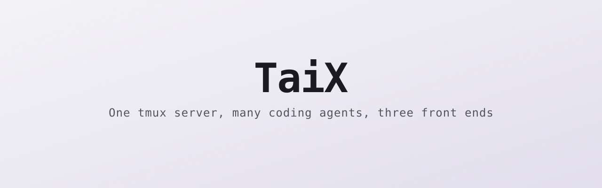
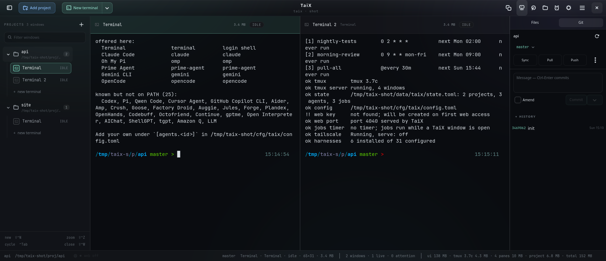

<p align="center">
  <picture>
    <source media="(prefers-color-scheme: dark)" srcset="assets/banner-dark.svg">
    <source media="(prefers-color-scheme: light)" srcset="assets/banner-light.svg">
    
  </picture>
</p>

<p align="center">
  <a href="https://github.com/Osyna/Taix/actions"></a>
  <a href="LICENSE"></a>
  
</p>

TaiX runs your AI coding agents as tmux windows and gives you three ways to
watch them: a GTK desktop window, a terminal UI, and a web page you open on
your phone. All three drive the same tmux server, so a pane you start on the
desktop is the pane you scroll on the sofa.



<sub>`demo.tape` in the repo root records the terminal UI as a GIF: `cargo build --release && vhs demo.tape`.</sub>

## Quick start

### Linux release packages

Download the packages for your distribution and `SHA256SUMS` from the
[latest release page](https://github.com/Osyna/Taix/releases/latest).

- **Portable CLI/TUI (any x86_64 Linux, static musl):** `taix-x86_64-linux-musl.tar.gz`
- **Native packages:** `taix` (CLI/TUI) as `.deb`, `.rpm` or Arch `.pkg.tar.zst`
- **Desktop GUI:** `taix-gui` native package, or `taix-gui-x86_64-linux-gnu.tar.gz`. Needs GTK 4.12+, libadwaita 1.5+ and WebKitGTK 6: Ubuntu 24.04+, Debian 13+, current Fedora, current Arch. Older distributions: use the portable CLI/TUI.

x86_64 only; no ARM builds.

```bash
# check the download against the checksum file on the release page
sha256sum -c SHA256SUMS --ignore-missing

# portable CLI
tar -xzf taix-x86_64-linux-musl.tar.gz
install -Dm755 taix-x86_64-linux-musl/taix ~/.local/bin/taix

# Ubuntu 24.04+ / Debian 13+
sudo apt install ./taix_0.3.1_amd64.deb ./taix-gui_0.3.1_amd64.deb
# Fedora
sudo dnf install ./taix-0.3.1-1.x86_64.rpm ./taix-gui-0.3.1-1.x86_64.rpm
# Arch
sudo pacman -U taix-0.3.1-1-x86_64.pkg.tar.zst taix-gui-0.3.1-1-x86_64.pkg.tar.zst
```
For CLI/TUI only, omit the `taix-gui` package. On Debian 12 and Ubuntu 22.04,
install only the CLI package; their desktop libraries are too old. The portable
archive also needs `tmux`, installed through your distribution's package manager.


Uninstall: `sudo apt remove taix taix-gui` / `sudo dnf remove taix taix-gui` / `sudo pacman -R taix-gui taix`; for the portable install, `rm ~/.local/bin/taix ~/.local/bin/taix-gui`. Your projects and settings under the XDG config/state directories are left alone.

TaiX does not update itself; install a newer release the same way.

### Build from source

Build from source with Rust and Cargo:

```bash
git clone https://github.com/Osyna/Taix.git
cd Taix
cargo build --release
install -Dm755 target/release/taix ~/.local/bin/taix
```

Make sure `~/.local/bin` is on your `PATH`.

You need `tmux` on `PATH`. Then:

```bash
taix add ~/code/my-project
taix
```

You get the terminal UI with your project in the sidebar. Press `n` to open an
agent window, `t` for a plain shell, `Enter` to type into the focused pane and
`Ctrl-]` to stop typing. `?` lists the keys, `q` quits.

`taix harnesses` shows which agent CLIs it found. The catalogue includes
Claude Code, Codex, Gemini CLI, Aider, Goose, Crush and OpenCode.
TaiX offers the ones on your `PATH`; add other harnesses in the config.

<details>
<summary>The desktop window, and what each distribution needs</summary>

The GTK front end is a separate binary needing GTK 4.12, libadwaita 1.5 and
WebKitGTK 6. A plain `cargo build` skips it, so the rest of the workspace
compiles on a machine with no GTK at all.

| | CLI + TUI | Desktop |
|---|---|---|
| Debian 13, Fedora 40+, Arch, openSUSE Tumbleweed | yes | yes |
| Ubuntu 24.04 | yes | yes |
| Debian 12, Ubuntu 22.04 | yes | no: GTK 4.8 / 4.6, libadwaita 1.2 / 1.1 |
| Alpine, anything musl | yes (static build) | build it yourself |

```bash
# Debian 13 / Ubuntu 24.04
sudo apt install libgtk-4-dev libadwaita-1-dev libwebkitgtk-6.0-dev tmux
# Fedora
sudo dnf install gtk4-devel libadwaita-devel webkitgtk6.0-devel tmux
# Arch
sudo pacman -S gtk4 libadwaita webkitgtk-6.0 tmux

cargo build --release -p taix --features gui
install -Dm755 target/release/taix ~/.local/bin/taix
install -Dm755 target/release/taix-gui ~/.local/bin/taix-gui
taix --gui
```

Use the current stable Rust toolchain from [rustup](https://rustup.rs) when
building from source.

</details>

Config lives at `$XDG_CONFIG_HOME/taix/config.toml` (or
`~/.config/taix/config.toml`). State lives at `$XDG_DATA_HOME/taix/` (or
`~/.local/share/taix/`).

## How it works

One tmux server holds every project's windows. A single `tmux -CC` control
connection carries all of it: command replies and every pane's output arrive
demultiplexed down one pty, so ten panes cost one connection rather than ten
emulators. The pane you are looking at is a live terminal emulator; the rest
are refreshed from batched `capture-pane` reads.

That is also why the front ends can disagree about what they are showing
without disagreeing about state: the desktop, the TUI and a phone can each
look at a different project, and closing all of them leaves the agents running
in tmux.

## The desktop

Projects sit in a sidebar, their agent windows tile as panes. The focused pane
takes the whole keyboard; TaiX keeps only `Ctrl+Shift`.

| Key | Action |
|-----|--------|
| `Ctrl+Shift+N` | New window |
| `Ctrl+Shift+T` | Toggle files panel |
| `Ctrl+Shift+G` | Toggle git panel |
| `Ctrl+Shift+B` | Open, or go to, this project's browser window |
| `Ctrl+Shift+P` | Command palette |
| `Ctrl+Shift+F` | Find in pane |
| `Ctrl+Shift+R` | Rename focused window |
| `Ctrl+Shift+W` | Close focused window |
| `Ctrl+Shift+K` | Stop focused window (offers to discard worktree) |
| `Ctrl+Shift+E` | Fold/unfold selected project |
| `Ctrl+Shift+Z` | Zoom focused pane |
| `Ctrl+Shift+M` | Mute/unmute selected project |
| `Ctrl+Shift+S` / `O` | Save / open a session |
| `Ctrl+Shift+J` | Automation (scheduled jobs) |
| `Ctrl+Shift+V` / `C` | Paste (images become file paths) / copy |
| `Ctrl+Shift++` / `-` / `0` | Pane font size |
| `Ctrl+Shift+1`…`9` | Focus the nth window of this project |
| `Ctrl+Shift+←` / `→` | Previous / next project |
| `Ctrl+Shift+↑` / `↓` | Scroll pane history one line |
| `Ctrl+Tab` | Cycle focus |
| `Shift+PgUp` / `PgDn` | Scroll pane history one page |

Drop one pane's header on another pane's **body edge** to split there, on its
**middle** to swap the two, and on its **header** to put both in one tab
group. A tab carries its window's state, so a background tab that needs
input says so without being opened. To leave a group: drag the tab onto
another pane, double-click it, or press the split button beside its close
button - the window takes half the pane back. Middle-click closes a tab.

Tabs are a desktop arrangement: underneath they are still separate tmux
windows, still visible to the TUI and the phone.

## The browser, and letting an agent drive it

A browser window is a window of a project, opened from the same menu as an
agent (or `Ctrl+Shift+B`), and it keeps its page when you switch to another
project and back. Each project can have several.

Any agent running in a TaiX pane can drive those windows through the MCP
server, so you watch it work on the page instead of reading about it:

```bash
claude mcp add taix taix mcp     # or: codex mcp add taix taix mcp
```

Settings has an **MCP** section with those lines, the config-file JSON and
the endpoint the browser tools use, each with a copy button, so nothing
here has to be typed from memory.

Ten tools, named after Playwright MCP's because that is what models already
know: `browser_tabs`, `browser_navigate`, `browser_snapshot`,
`browser_click`, `browser_type`, `browser_press_key`, `browser_evaluate`,
`browser_wait_for`, `browser_console`, `browser_screenshot`.

The token budget is the design. `browser_snapshot` returns an accessibility
outline of the interactive and structural nodes only - `- button "Save"
[ref=e7]` - capped and cut to what fits; `filter` narrows it to the matches
and their path. Every other tool answers in one line ("clicked button
\"Save\""), never a fresh tree, so a ten-step flow costs one snapshot, not
ten. Screenshots exist but are the last resort, not the interface.

```
browser_navigate {"url": "localhost:5173"}     -> http://localhost:5173/ · Order form
browser_snapshot {}                            -> 8 lines with refs
browser_type     {"ref": "e4", "text": "Ada"}  -> typed "Ada" into input:text
browser_click    {"ref": "e7"}                 -> clicked button "Place order"
browser_console  {}                            -> log: order Ada s
```

`browser_tabs {"action":"new","headless":true}` opens a window with no card
on screen: same driving, nothing taking up the grid, for the checks you do
not want to watch. Headless windows have no screenshot - there is no surface
to photograph - and are marked *headless* in the window list.

The tools talk to the running desktop over its own LAN port on localhost, so
`taix --gui` has to be up; without it they say so rather than hanging.

## The phone

Turn the web server on in Settings or set `web.enabled = true`. It listens on
port 4040 and the status bar shows the LAN address to type.

The main interface requires pairing. A device with no pairing cookie gets a
pairing page; the desktop raises an amber chip, you tap Pair or Deny, and the
approved device gets a cookie bound to its IP. The key lives at
`$XDG_DATA_HOME/taix/web.key` (mode 0600) and survives restarts. Rotate it from
the pairing popover to drop every paired device at once.

Set `web.tailscale = true` to bind the tailnet address instead of every
interface. *HTTPS over Tailscale* in Settings → Web runs `tailscale serve` for
you; the pairing link and its QR code then point at the `https://….ts.net`
address. Scan the code with the phone's camera to pair.

The phone page is a real terminal, not a log viewer: the browser picks a
legible font size, derives the grid from its own screen and tells the desktop
to resize the tmux window to match, so you are never reading a 137-column pane
through a keyhole.

The page holds one WebSocket to the desktop: every change - a new window, a
state flip, a screen - arrives as it happens, and keystrokes go up the same
connection in order. When the connection drops, it reconnects by itself.

Each page receives only the panes it is watching and the rows that changed.
A hidden tab stops receiving pane updates.

It also installs as an app. Over HTTPS (the `tailscale serve` address, or
`localhost`) the browser offers "Install" - or pick *Install TaiX as an app*
from the command palette - and the installed app opens even while the
desktop is unreachable, then reconnects. Over plain HTTP on the LAN,
browsers refuse service workers, so there is no offline start or install
prompt there.

Over HTTPS, Settings on the phone offers two more things: lock-screen alerts
when an agent waits (Web Push - on iPhone only from the Home Screen app; the
VAPID key and subscriptions live in `$XDG_DATA_HOME/taix/`), and *Require
Face ID on this device*, a passkey the server checks before it lets that phone
in again after five idle minutes or a restart.

On the terminal itself: swipe sideways for the next window, drag to scroll
(it reaches full-screen programs as the wheel), long-press to select and copy
rows. Long-press a key in the row to add your own. Turn the phone sideways for
two terminals at once.

The first key in the key row switches between a staged line and live typing.
Use live typing for shell completion and interactive TUIs. Attach files with
the picker, paste a screenshot, or type `@` to find a project file; numbered
chips let you refer to each attachment in the line.

### Sharing a terminal

**Share read-only** in a window's menu creates a link to that window's screen.
Anyone with the link can view it without pairing, so check the terminal for
credentials and private addresses before sharing. Links expire after an hour;
revoke them in Settings → Read-only links. Rotating the pairing key revokes
all of them.

Name each browser in Settings → This device. Other devices show who is driving
a window; **Send to…** offers a window to another connected browser.

An iPad gets the desktop's layout instead: projects, terminal, panels. In
portrait the project list is a drawer behind ☰. You type straight into the
pane, so a hardware keyboard works the way it does on a laptop (⌘K palette,
⌘1-9 windows, ⌘[ ⌘] previous and next). With the on-screen keyboard up, the
key row sits above it for esc, tab, arrows and a sticky ctrl.

## Headless, in a Proxmox LXC

TaiX can run with no display: a headless sway hosts the window and the web
page on port 4040 is the whole interface (the desktop layout in a laptop
browser, the phone layout on a phone). On a Proxmox VE host, with `taix` and
`taix-gui` built by `cargo build --release -p taix --features gui`:

```bash
packaging/proxmox/taix-lxc.sh target/release        # new CT, next free id
packaging/proxmox/taix-lxc.sh target/release "$CT_ID" # set CT_ID to the container to update
```

It creates an unprivileged Debian 13 container (`STORAGE`, `BRIDGE`,
`MEMORY`, `CORES`, `DISK` override the defaults), installs tmux, sway and the
GTK runtime, makes zsh with oh-my-zsh root's shell, installs Oh My Pi (`omp`),
passes `/dev/net/tun` through for Tailscale, enables
`taix-host.service` and prints the pairing link with its key. Nobody is at a
screen to press Approve, so pair with that link. Restarting the service
keeps the tmux server and every agent in it.

## Scheduled jobs

Jobs run a shell command, open a harness with a prompt, restore a session, or
run a git operation. They fire while any TaiX window is open; install the
systemd user timer to keep them firing when everything is closed.

```bash
taix jobs                                  # list all jobs
taix jobs add <name> --at <when> ...       # create a job
taix jobs rm|on|off|run <id|name>          # delete, enable, disable, run now
taix jobs log <id|name> [-n <lines>]       # output of past runs (default 200)
taix jobs history [<id|name>] [-n <runs>]  # exit codes and durations
taix jobs install                          # systemd user timer, wakes each minute
taix jobs uninstall
```

`--at` takes `@hourly` / `@daily` / `@weekly` / `@monthly` / `@yearly`,
`@every 90m`, five cron fields, or a one-shot `YYYY-MM-DD HH:MM` that disables
the job after it fires. Cron fields take `*`, `*/n`, `a-b`, `a,b` and `n`, and
month and weekday names in either form:

```bash
--at "@every 30m"
--at "0 9 * * mon-fri"     # 09:00 on weekdays
--at "0 0 1 jan,jul *"     # midnight on 1 January and 1 July
--at "2026-12-25 09:00"    # once
```

`--on <event>` replaces the clock: `agent-waiting`, `agent-idle`, `port-up:5173`
(a window started serving that port), `job-done:<id>` (that job just
succeeded, so `--on job-done:3` is "run after job 3") or `job-failed:<id>`.
The open window reports each event once as it happens; a job never runs twice
for one. Each run's output is kept (64 KiB, last 20 runs) and shows on the web
page's Jobs panel, where a run can be run again.

Cron arithmetic is done in local civil time, so a job at 09:00 stays at 09:00
across a DST change rather than drifting an hour.

Pick exactly one action:

- `--run <command>` — a shell command
- `--agent <harness> --ask <prompt>` — open an agent and type a prompt
- `--session <name>` — restore a saved session
- `--git <op>` — `fetch`, `pull`, or `push`

And optionally: `--project <p>` (id, name or path; required for `--agent`),
`--cwd <dir>`, `--timeout <secs>` (default 900), `--notify never|failure|always`,
`--reuse` to take over an existing window, `--no-catch-up` to skip a job that
was already overdue when TaiX started. `{project}`, `{root}`, `{date}` and
`{time}` expand inside `--run` and `--ask`.

## Shell integration

A shell that marks its prompts with OSC 133 lets TaiX remember what each
terminal ran. The web page's **History** panel (clock icon) lists the shown
window's commands with ✓/✗ exit status and duration, and its search box looks
through every window; the **↑ ↓** buttons in a pane's header jump to the
previous/next prompt in its scrollback. Without the marks both stay empty.

```bash
# bash, in ~/.bashrc (PS0 needs bash 4.4)
PROMPT_COMMAND='printf "\e]133;D;%s\a\e]133;A\a" "$?"'"${PROMPT_COMMAND:+;$PROMPT_COMMAND}"
PS1="$PS1"'\[\e]133;B\a\]'
PS0=$'\e]133;C\a'

# zsh, in ~/.zshrc
precmd()  { print -n "\e]133;D;$?\a\e]133;A\a" }
preexec() { print -n "\e]133;C\a" }
PS1="$PS1%{"$'\e]133;B\a'"%}"
```

fish 4.0 and newer send the marks on their own. Prompt frameworks usually have
an option for them too (Powerlevel10k: `POWERLEVEL9K_TERM_SHELL_INTEGRATION=true`),
and a framework that rebuilds `PS1` each prompt needs the `B` mark added there
instead. TaiX keeps the last 200 commands per window in memory only. The command
text is read from what the shell echoed, so a line edited with cursor keys can
read wrong; fish sends the exact line.

## Other ways in

```bash
taix -t                 # list projects with their ids
taix -t -s <id>         # open one as a plain tmux session, laid out like the GUI
taix mcp                # MCP stdio server, so an agent can drive TaiX
taix save|sessions|restore <name>
taix doctor             # config, tmux server and harness health
```

`isolate = true` gives every new window its own git worktree on its own
branch, and closing the window offers to merge it back or throw it away.

## Config reference

All keys go in `$XDG_CONFIG_HOME/taix/config.toml`.

| Key | Default | Description |
|-----|---------|-------------|
| `tmux_socket` | `"taix"` | tmux socket name (the `-L` argument) |
| `tmux_session` | `"taix"` | tmux session name |
| `idle_after_ms` | `2000` | milliseconds of quiet before an agent counts as idle |
| `theme` | none | theme name (omit for the system default) |
| `font_size` | `10.0` | pane font size in points |
| `browser_home` | `"about:blank"` | browser panel landing page |
| `editor` | none | editor command or catalogue id (`code`, `nvim`, …); falls back to `$VISUAL`, `$EDITOR` |
| `isolate` | `false` | give every new window its own git worktree on a branch |
| `bar` | `["where", "branch", "window", "windows", "memory"]` | bottom bar segments (`where`, `branch`, `window`, `windows`, `memory`, `uptime`, `empty`) |
| `reap_idle_after_ms` | none | stop an agent after this long idle (omit to never reap) |
| `harness_order` | `[]` | harness ids in menu order; the rest follow in catalogue order |
| `web.enabled` | `true` | start the web server |
| `web.port` | `4040` | web server port |
| `web.tailscale` | `false` | bind the tailnet address only |

Add or override a harness in `[agents.<id>]`:

```toml
[agents.claude]
label = "Claude"
command = "claude"
icon = "claude"
color = "blue"
hidden = false
```

Every field is optional; omitted ones keep the catalogue default.

## What it does not do

- **Linux only.** It reads `/proc` and installs systemd user units; building it
  anywhere else fails at compile time rather than misbehaving at runtime.
- **x86_64 only, no self-update.** Release packages are x86_64 Linux; install newer releases by hand.
- **No agent API of its own.** TaiX runs whatever CLI you already have and reads
  its terminal. It does not talk to model providers, and it holds no API keys.
- **One tmux server.** Everything shares the socket named in `tmux_socket`; kill
  that server from outside and the windows go with it (the layout is restored
  from the store on the next start).

## Troubleshooting

```bash
taix doctor
```

TaiX keeps going when something it can live without fails: a capture that did
not answer, a `git` invocation that errored, a request it refused. Those are
silent by design. `TAIX_LOG=1` prints them to stderr instead:

```bash
TAIX_LOG=1 taix --gui
```

**Port already in use:** something else holds the web port. Change `web.port`
or stop it.

**tmux server gone:** the session was killed from outside. Close the window and
reopen; the layout comes back from the store.

**Agent not found:** the harness command is not on the `PATH` TaiX sees. Check
`taix harnesses`. A desktop launcher inherits the session `PATH`, not your
shell's — start `taix --gui` from a terminal to compare.

## Desktop entry

```bash
install -Dm644 packaging/dev.taix.TaiX.desktop \
  ~/.local/share/applications/dev.taix.TaiX.desktop
```

## Documentation

See [CHANGELOG.md](CHANGELOG.md) for changes, including the web terminal,
scheduled jobs, shell history, and headless deployment.

## Publishing screenshots and diagnostics

Before sharing a screenshot or diagnostic output, check for pairing links,
terminal contents, personal paths, LAN addresses, and tailnet hostnames. Keep
`web.key`, push credentials, local state, and crash dumps out of commits. A
`.gitignore` rule does not remove a file or identifier from existing commits.

## Contributing

Issues and pull requests are welcome — see [CONTRIBUTING.md](CONTRIBUTING.md)
for the build, the test commands and what CI will run against your branch.
Security reports go through [SECURITY.md](SECURITY.md), not the issue tracker.

## License

[Apache-2.0](LICENSE).
